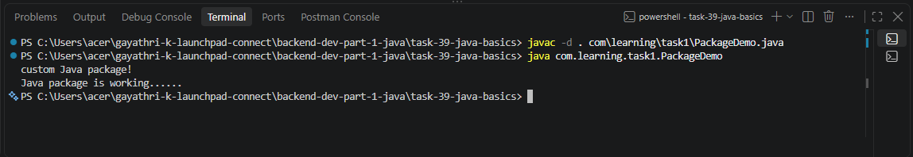

# Java - Basics

# Java Package and Compilation

A package in Java is used to organize related classes. It helps maintain a structured project and avoid naming conflicts.

# Comile and Run the package program

- compile
    javac -d . com/learning/task1/PackageDemo.java
- run
    java com.learning.task1.PackageDemo

# ScreenShot

# Differece Between JDK, JRE

## JDK - Java Developement Kit

- Developing and executing Java applications.

- It is a complete software development environment used to develop, compile, debug, and run Java applications. 

- The JDK is platform-dependent and available for operating systems such as Windows, macOS, Linux, and Solaris.

- The JDK includes:
       - Java compiler (javac)
       - Java launcher (java)
       - Debugger, documentation tools, and other utilities
       - Java Runtime Environment (JRE)

## JRE - Java Runtime Environment

- It provides the runtime environment required to execute Java programs. 

- It does not include development tools such as compilers or debuggers.

- The JRE consists of:
       - Java Virtual Machine (JVM)
       - Core Java class libraries
       - Supporting files required for program execution